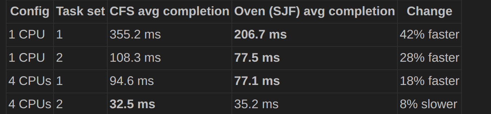
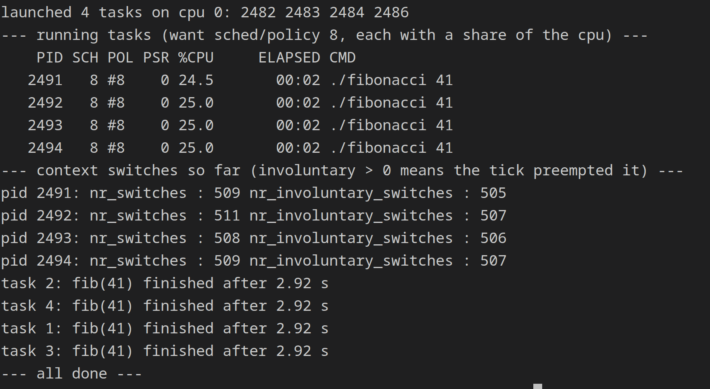
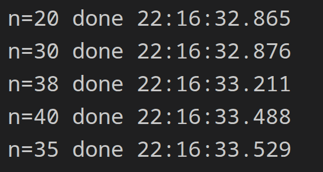
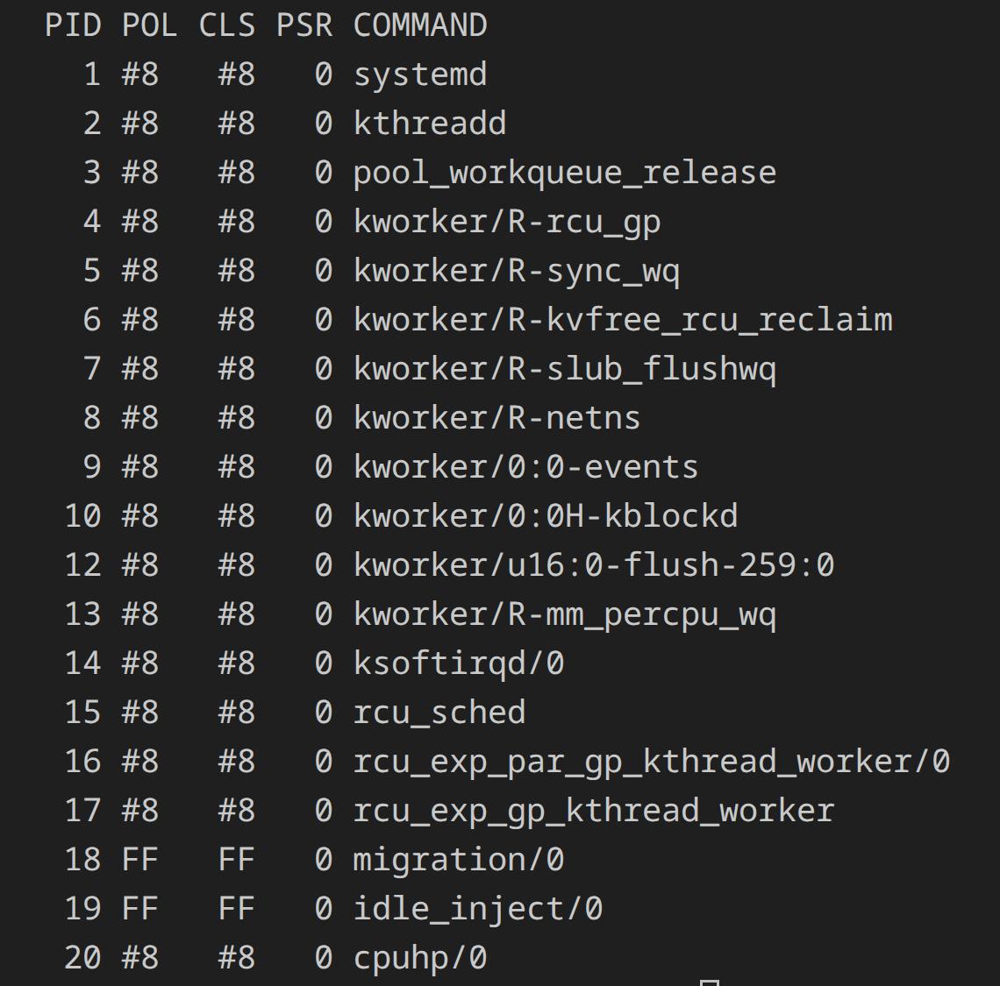
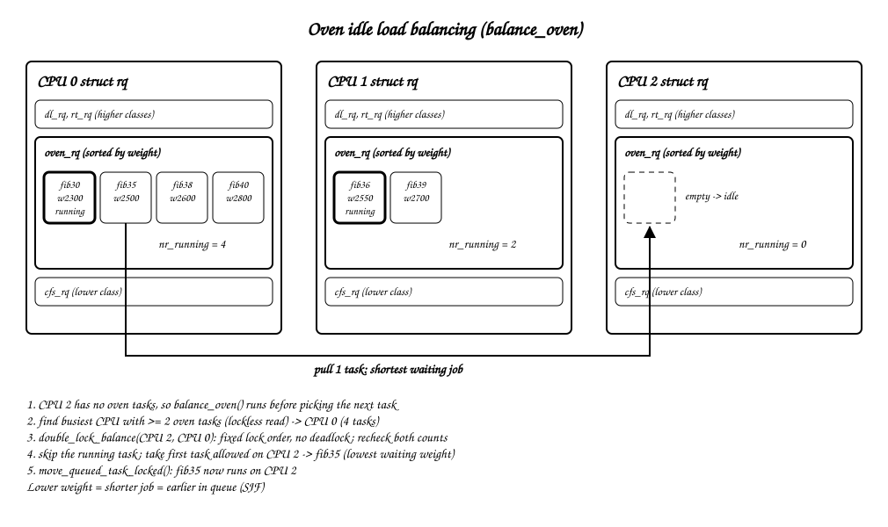

# Oven Scheduler

A custom Linux scheduling class (`SCHED_OVEN`, policy 8) in
`linux/kernel/sched/oven.c`, compared against CFS on fib() workloads.

## Results

### Oven vs CFS (average completion time)

| Config | Task set | CFS | Oven (SJF) | Change |
| --- | --- | ---: | ---: | --- |
| 1 CPU | 1 | 355.2 ms | **206.7 ms** | 42% faster |
| 1 CPU | 2 | 108.3 ms | **77.5 ms** | 28% faster |
| 4 CPUs | 1 | 94.6 ms | **77.1 ms** | 18% faster |
| 4 CPUs | 2 | **32.5 ms** | 35.2 ms | 8% slower |

Oven wins in 3 of 4 runs. CFS wins only on 4 CPUs with task set 2.

### Round robin

4 × `fib(41)` on CPU 0 under policy 8: each gets ~25% CPU, ~505
involuntary switches each, and all finish at 2.92 s.

### SJF completion order

| n | Done at |
| --- | --- |
| 20 | 22:16:32.865 |
| 30 | 22:16:32.876 |
| 38 | 22:16:33.211 |
| 40 | 22:16:33.488 |
| 35 | 22:16:33.529 |

### Oven as default scheduler

After boot, `systemd`, `kthreadd`, kworkers and RCU threads all run under
policy 8. Only `migration/0` and `idle_inject/0` stay on FIFO (`FF`).

### Idle load balancing

A CPU with an empty `oven_rq` pulls one task from the busiest CPU that has
at least 2 Oven tasks. It takes the shortest waiting job (lowest weight)
and never the running one. Code: `balance_oven()` in
`linux/kernel/sched/oven.c`. Editable source:
[`img/load_balancing.excalidraw`](img/load_balancing.excalidraw).
